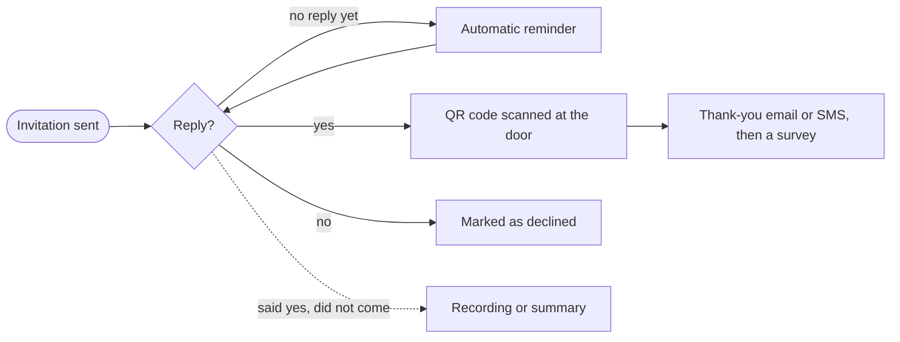

<picture>
  <source media="(prefers-color-scheme: dark)" srcset="header-dark.svg">
  
</picture>

  
  
  
  
  

Bienvenue Event is the software French ministries, local authorities and large companies use when every guest is invited by name. Bsoft, a software company near Lyon in the Visiativ group, has built it since 2013. 7,500 events so far.

It isn't a ticketing tool: there's no online payment and no transferable ticket. You decide who's on the list, and we follow each guest from the first invitation to the thank-you message.

### From the guest list to the report

| Step | What you get |
|---|---|
| [Guest list](https://www.bienvenue-event.com/en/guest-list-management/) | Import from CSV or Excel. Duplicates are caught on name and email, and each guest gets a category. |
| [Invitations](https://www.bienvenue-event.com/en/event-invitations/) | Designed to your brand, with an RSVP page, its own form and workshops capped at the number of seats you have. |
| [Replies and reminders](https://www.bienvenue-event.com/en/rsvp-tracking-reminders/) | Answers arrive live. Whoever hasn't replied gets a reminder at the hour you've set. |
| [Check-in](https://www.bienvenue-event.com/en/event-check-in-app/) | QR codes scanned on iOS or Android tablets, offline since 2015, with several devices kept in sync. |
| [Report](https://www.bienvenue-event.com/en/event-report/) | PDF attendance report the moment the event closes; CSV and Excel exports. |
| [Afterwards](https://www.bienvenue-event.com/en/post-event-survey/) | Thank-you emails or texts sent by attendance status, then a satisfaction survey. |
| [General meetings](https://www.bienvenue-event.com/en/general-meeting-voting/) | Sign-in, proxies, live quorum, SMS voting. |

### A guest's path

### Good to know

Your data stays in France. IT can plug in the single sign-on you already run, so staff log in with their usual accounts and the organisation's directory stays the source of identities. French public bodies can buy it through UGAP, agencies get a white-label version, and there's no cap on users: you pay per event or take an annual licence. One thing to know before a demo, though. The admin interface is in French.

[Request a demo](https://www.bienvenue-event.com/en/demo/) · [Pricing](https://www.bienvenue-event.com/en/pricing/) · [Security and GDPR](https://www.bienvenue-event.com/en/gdpr-data-hosting/)

### En français

Bienvenue Event sert aux événements où chaque invité est attendu par son nom. Vous importez la liste, envoyez les invitations et relancez ceux qui n'ont pas répondu ; le jour J, les hôtesses scannent les QR codes sur tablette, même sans réseau, et vous avez le rapport de présence en PDF dès la fin de l'événement. Bsoft l'édite près de Lyon depuis 2013 pour les ministères, les collectivités et les grandes entreprises. Les données sont hébergées en France.

[Demander une démonstration](https://www.bienvenue-event.com/demonstration/)
